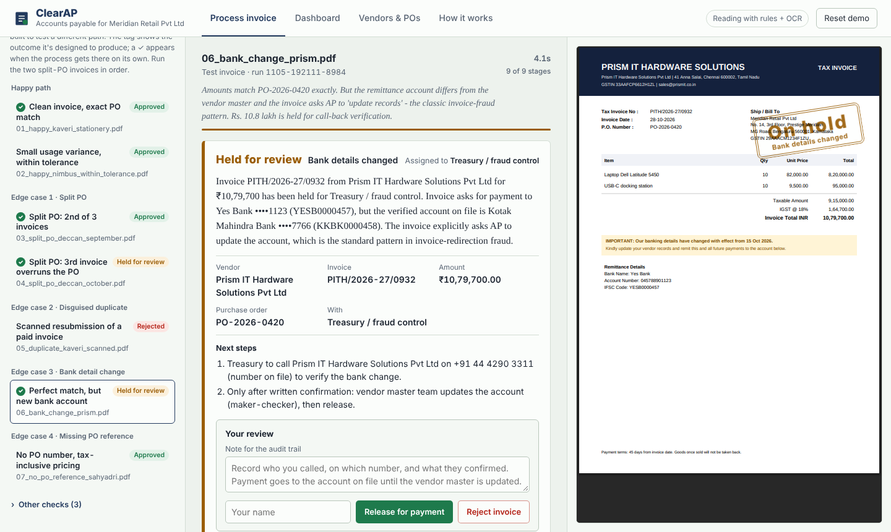
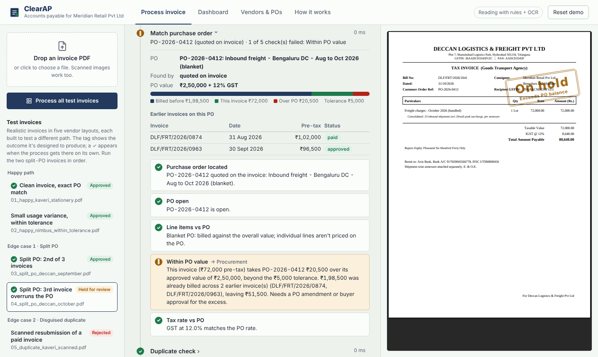
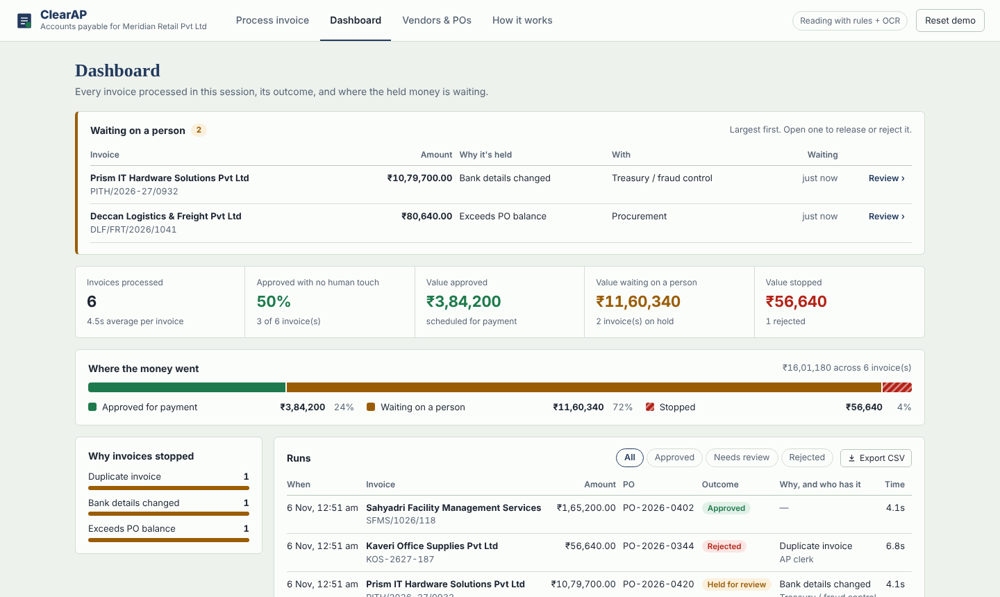

# ClearAP: invoice PDF to payment decision

ClearAP takes a vendor invoice, either a clean PDF or a scanned image, and decides what happens to the money: **approve** it for payment, **hold** it for a named person, or **reject** it. Every stage runs live on screen, and every decision comes with its reasons, the person who owns the next step, and a drafted query to the vendor where one is needed.

Built for the Zamp AI Solutions Associate case study, problem statement 1 (invoice processing).

**Live process:** https://clearap.onrender.com (free hosting; the first load can take up to a minute)

**Demo video:** [5-minute walkthrough](LOOM_LINK_HERE)



## The idea

**The AI reads the invoice. Fixed, auditable rules decide what happens to the money. Anything uncertain goes to a named person with the reason attached.**

Reading invoices is where the variety lives: different layouts, scans, bundled line items, tax hidden inside prices. That is the part an LLM is good at. Deciding whether to pay ₹10 lakh is the part a finance team needs to audit, test and repeat exactly, so it is done by rules that can be read line by line. The two never mix: the model never makes the payment decision, and the decision never depends on the model being available.

```
 Browser (HTML/CSS/JS, no build step)
   │  upload or pick an invoice ─────► POST /api/runs
   │  live stage updates ◄─────────── Server-Sent Events
   ▼
 FastAPI ─► Pipeline: 9 stages, one event per stage
              ├─ Read        PDF text layer, or Tesseract OCR for scans
              ├─ Extract     Reader A: rule-based parser
              │              Reader B: Gemini (text, plus the page image for scans)
              │              agree → trusted · disagree on money → arithmetic tie-break or a person
              ├─ Rules       validation, vendor, PO, duplicates → approve / hold / reject
              ├─ Explain     summary, owner, next steps, vendor email
              └─ Data        vendor master + POs (CSV) · ledger, runs, audit trail (SQLite)
```

## The four edge cases

Each needs a different capability, and each maps to a way accounts-payable teams actually lose money.

| Edge case | Why it's hard | What ClearAP does |
|---|---|---|
| **Split PO overrun.** A blanket freight PO is billed monthly; the third invoice is fine on its own. | Nothing is wrong with the invoice itself. It only fails when added to the earlier invoices on the same PO. | Tracks the PO balance across invoices. Holds it for procurement: ₹20,500 over the approved value. A reviewer can release it with a note. |
| **Disguised duplicate.** A scanned copy of a paid invoice, with the number reformatted (`KOS/26-27/0187` → `KOS-2627-187`). | It's a scan, so there's no text layer; and an exact-match duplicate check sees two different numbers. | Reads it with OCR and the vision model, compares digit patterns alongside vendor, PO, date and amount. Rejected as a duplicate. |
| **Bank detail change.** A ₹10.8 lakh invoice that matches its PO exactly but asks for payment to a new account. | Every amount check passes. The only signal is the bank account, plus a request to "update your records". | Holds it for treasury, with instructions to call back on the number already on file, never one from the invoice. This is the most common invoice-fraud pattern. |
| **No PO number, tax-inclusive pricing.** | The PO has to be inferred, and the GST is inside the price. | Backs out the tax, scores the vendor's open POs on amount and description, and accepts only a clear winner. The match is flagged as inferred. |

Three more invoices cover a unit price above the PO, missing invoice number and date, and a blocked vendor.



## How it meets the brief

| The brief asks for | In ClearAP |
|---|---|
| A process that runs live on real inputs | Upload any invoice PDF, or use the ten test invoices (five vendor layouts, one scanned). Deployed at the link above. |
| A run view that shows each step as it executes | Nine stages stream in as they happen, each expandable to show what was read, checked and decided. |
| A dashboard with history, status and outputs | Queue of invoices waiting on a person, value approved / waiting / stopped, reasons, every run with replay, filters and CSV export. |
| 2–4 non-trivial edge cases | The four above, each exercising a different capability. |
| Clear explanation for a non-technical buyer | Every decision has a plain-English summary, an owner and next steps. "How it works" explains the design and lets you change the policy live. |
| A person stays in control | Held invoices are released or rejected with a required note; some holds can't be overridden; every action is in a downloadable audit trail. |



## What it checks, stage by stage

| Stage | What happens |
|---|---|
| Read document | Uses the PDF text layer, or OCR (Tesseract) when the PDF is a scanned image. |
| Extract fields | Rule-based parser, plus an LLM as a second reader: Gemini when `GEMINI_API_KEY` is set (free tier), or Claude when `ANTHROPIC_API_KEY` is set. Fields both readers agree on are trusted; disagreements go to a human. If the AI call fails, the rule-based reading is used and the run says so. |
| Validate | Mandatory fields, arithmetic (lines → subtotal → tax → total), GSTIN format and checksum, billed to the right entity, correct GST type (CGST+SGST vs IGST), date sanity. |
| Verify vendor | In the master (matched by GSTIN, then name), not blocked, GSTIN matches, **bank account matches the verified account on file**. |
| Match PO | Quoted PO, or inferred from the vendor's open POs when none is quoted. Line-level price and quantity vs PO, cumulative balance across split invoices, tax rate. |
| Duplicate check | Exact number in any format, reformatted numbers (digit similarity + same PO/date/amount), and same-amount-same-period suspects. |
| Decide | Most severe rule outcome wins. Nothing is averaged away. |
| Explain & route | Plain-English summary, owner, next steps, vendor email draft, ledger update. |
| Review queue | The dashboard lists every held invoice waiting on a person, largest first, with who has it and how long it has waited. Click one to release or reject it. |
| Batch run | "Process all test invoices" runs the whole inbox live, one invoice after another, then opens the dashboard. Run it after "Reset demo". |
| CSV export | Export every run (outcome, reason, owner, review status, timing) from the dashboard, or GET `/api/runs.csv`. |
| Editable policy | On "How it works", change the tolerance %, tolerance cap and duplicate window. New runs use the new values, each run records the policy it was decided under, and "Reset demo" restores the defaults. API: `GET/PUT/DELETE /api/policy`. |
| Human review | A reviewer releases or rejects a held invoice with a required note. Release updates the ledger and PO balance; every action lands in the audit trail. Some holds can't be overridden (no invoice number, unknown vendor, not an invoice). |

## Test invoices

`samples/` holds ten invoices in five vendor layouts; `scripts/generate_invoices.py` regenerates them. The four headline edge cases:

1. **Split PO**: a blanket freight PO billed monthly. The third invoice is fine on its own but takes the PO ₹20,500 over its value → held for procurement.
2. **Disguised duplicate**: a scanned copy of an already-paid invoice with its number reformatted (`KOS/26-27/0187` → `KOS-2627-187`) → rejected. An exact-match check misses it.
3. **Bank detail change**: a perfect PO match, but the invoice asks for payment to a new account → held for treasury call-back on the number on file.
4. **Missing PO reference**: no PO quoted and GST-inclusive pricing → tax backed out, PO inferred from the vendor's open POs, flagged as inferred.

Also included: unit price above PO, missing invoice number and date, and a blocked vendor.

Tests (no network needed):

```bash
python -m tests.test_scenarios   # all 10 invoices, expected decision for each
python -m tests.test_ai_path     # simulated LLM: realistic output, misread totals, outages
python -m tests.test_review      # reviewer guardrails, ledger and PO balance effects
python -m tests.test_policy      # editable policy: validation, and 0% vs 2% tolerance on the same invoice
```

## Run locally

Needs Python 3.11+ and Tesseract (`brew install tesseract` / `sudo apt install tesseract-ocr`).

```bash
pip install -r requirements.txt
export GEMINI_API_KEY=...              # optional, free tier: adds Gemini as a second reader
uvicorn app.main:app --reload
# open http://localhost:8000
```

## Deploy (Render, free tier)

1. Push this folder to a GitHub repo.
2. In Render: **New → Blueprint**, pick the repo. It reads `render.yaml` and builds the Dockerfile.
3. In the service's **Environment** tab, set `GEMINI_API_KEY` (free key from Google AI Studio; optional but recommended).
4. Share the `https://clearap-xxxx.onrender.com` URL.

Free Render services sleep after inactivity and take about a minute to wake. Open the link a couple of minutes before the interview, then press **Reset demo**.

## Configuration

| Variable | Default | Meaning |
|---|---|---|
| `GEMINI_API_KEY` | unset | Enables Gemini as the second reader (free tier). Takes priority if both keys are set. |
| `GEMINI_MODEL` | `gemini-3.6-flash` | Gemini model used. |
| `ANTHROPIC_API_KEY` | unset | Enables Claude instead (paid API). |
| `ANTHROPIC_WORKSPACE_ID` | unset | Only needed if your API key isn't scoped to a workspace. |
| `ANTHROPIC_MODEL` | `claude-sonnet-5-5` | Model used for extraction. |
| `TOLERANCE_PCT` | `2.0` | Allowed over-billing vs PO, as % of PO value. |
| `TOLERANCE_ABS_CAP` | `25000` | Tolerance never exceeds this many rupees. |
| `LLM_TIMEOUT_S` | `25` | Give up on a model call after this long (one retry on busy/rate-limit errors), then continue with the rule-based reader. |
| `LLM_POLISH` | `0` | Set to `1` to let the model reword decision summaries (one extra call per invoice). |
| `STAGE_DELAY_MS` | `450` | Pause between stages so the live view is readable. |
| `CLEARAP_TODAY` | today | Pin the clock for date checks. |

## Project layout

```
app/
  main.py        HTTP API + live event stream (SSE)
  config.py      policy values, model settings, timeouts
  pipeline.py    runs the nine stages, emits an event per stage
  extract.py     text layer / OCR, rule-based parser, LLM reader, reconciliation
  llm.py         Gemini / Claude wrapper (whichever key is set)
  rules.py       every validation, vendor, PO and duplicate rule + the decision
  explain.py     summary, next steps, vendor email
  db.py          vendor master + POs (CSV), ledger and run history (SQLite)
  gstin.py       GSTIN checksum
data/            vendor master, POs, PO lines, opening invoice ledger
samples/         test invoices + manifest.json
static/          the UI (no build step)
scripts/         invoice generator
tests/           scenario, AI-path, review and policy tests
docs/            screenshots
```

## Assumptions

- The buyer is a single Indian entity in Karnataka, so GST type is checked: CGST + SGST for Karnataka suppliers, IGST for everyone else.
- Matching is 2-way (invoice to PO). There's no goods-receipt data; adding a GRN table makes it 3-way with the same rule structure.
- PO balance is consumed by paid and approved invoices, on the pre-tax amount. Held invoices don't consume balance until a reviewer releases them.
- Blanket POs (service contracts billed monthly) are matched on overall value, not line prices.
- An inferred PO is accepted only when one candidate clearly wins on amount and description; otherwise procurement decides.
- A changed bank account is never accepted from an invoice, even with a perfect PO match.

## Known limitations

- Two-way match only; there's no goods-receipt data.
- The rule-based line-item parser expects one row per line; unusual tables rely on the LLM reader.
- Single-entity, INR-only. Multi-currency would add an FX step before PO matching.
- No authentication. Run history and the ledger are SQLite and reset when the container restarts.
- Email ingestion is not wired up. The pipeline takes a PDF; an inbox watcher would call the same `/api/runs` endpoint.
